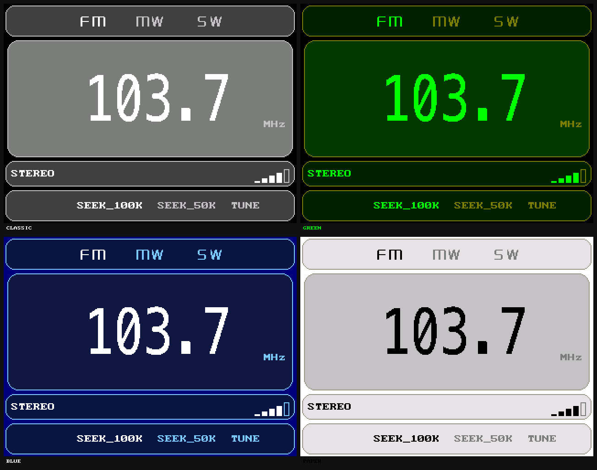

# TEF6686_ESP32C3 数字收音机

基于 **ESP32-C3** 与 **NXP TEF6686** 的便携式数字收音机，配备 **ILI9341（320×240，SPI）** 彩色屏幕，使用旋转编码器与按键操作。

## 功能特性

- **三波段接收**
  - **FM**：87.5 – 108.0 MHz，0.1 MHz 步进，支持 SEEK 100 kHz / 50 kHz
  - **MW / AM**：531 – 1710 kHz，9 kHz / 1 kHz 步进
  - **SW 短波**：2300 – 27000 kHz，5 kHz / 500 kHz 步进
- **两种调谐方式**：旋转编码器手动逐级调台；SEEK 自动向上/向下搜台并落台。
- **搜台可中止**：搜台过程中转动旋钮或按下按键立即停止，按键中止不会切换当前模式。
- **操作跟手**：旋钮与按键均为中断响应（20 ms 防抖），搜台采用非阻塞状态机，搜台全程界面与按键保持响应。
- **清晰界面**：圆角色块四区布局（波段栏 / 频率面板 / 状态栏 / 模式栏），大号字体显示频率，状态栏实时显示信号强度条与立体声/单声道状态。
- **5 种屏幕配色**：经典黑白、琥珀复古、绿色荧光、深蓝冰蓝、白纸反色。
- **状态记忆**：自动记忆并开机恢复波段、频率、步进、模式、底栏选中项与屏幕配色，写入 EEPROM 时做了磨损均衡。

## 操作方式

| 操作 | 功能 |
|---|---|
| 旋转编码器 | TUNE 模式下逐级调台；SEEK 模式下启动搜索 |
| 单击按钮 | 切换步进 / 调谐模式 |
| 双击按钮 | 切换屏幕配色 |
| 长按按钮 | 切换波段（FM / MW / SW） |
| 搜台中转动或按键 | 中止搜台 |

## 硬件要求

| 部件 | 说明 |
|---|---|
| 主控 | ESP32-C3（WeAct Studio Core Board） |
| 收音机前端 | NXP TEF6686（含 9.216 MHz 晶振） |
| 显示屏 | ILI9341 SPI 320×240 |
| 状态存储 | I2C EEPROM（AT24C64） |
| 输入 | 旋转编码器 + 按键 |

## 引脚分配

| 功能 | ESP32-C3 GPIO |
|---|---|
| 编码器 A / B | GPIO3 / GPIO1 |
| 按键 | GPIO2 |
| 收音机电源使能 | GPIO0 |
| TFT SCK / MOSI | GPIO4 / GPIO6（硬件 SPI 默认引脚） |
| TFT CS / DC / RST | GPIO7 / GPIO21 / GPIO20 |
| I2C SDA / SCL | GPIO8 / GPIO9（TEF6686 与 EEPROM 共用） |

> 引脚以 `src/radio.ino` 顶部的 `#define` 为准。

## 编译与烧录

使用 **PlatformIO**，显示驱动依赖 `gavinlyonsrepo/ILI9341_LTSM` 已在 `platformio.ini` 声明，首次编译自动下载。

```bash
# 编译
pio run

# 烧录（替换为实际串口）
pio run --target upload --upload-port COM6

# 串口监视（115200 波特）
pio device monitor -p COM6 -b 115200
```

> 若无声音或信号：请检查 TEF6686 模块的 9.216 MHz 晶振是否起振、供电是否充足，以及 I2C 走线与上拉。
